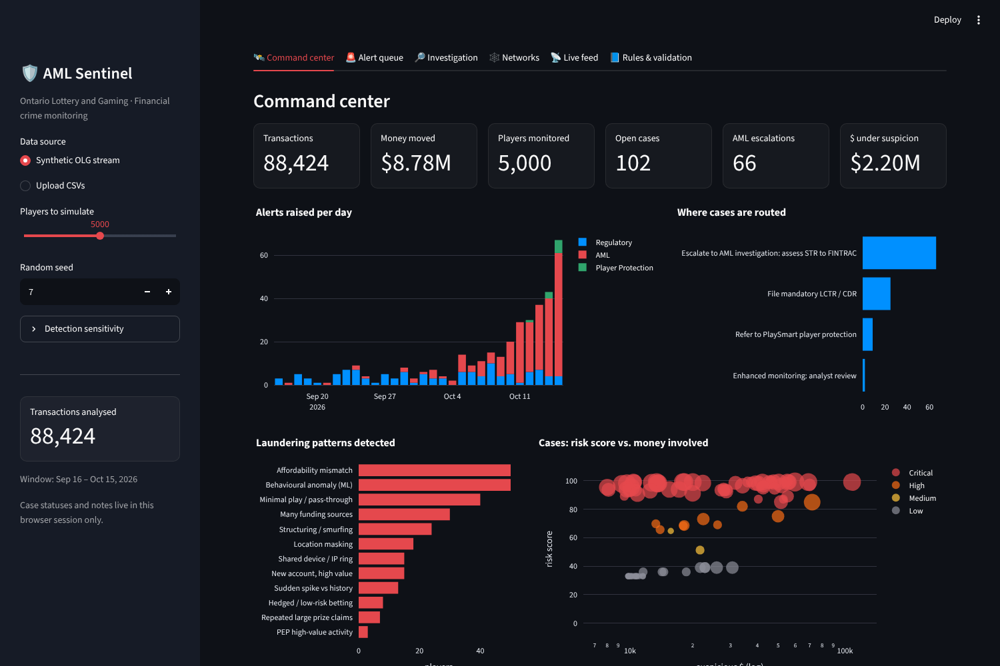
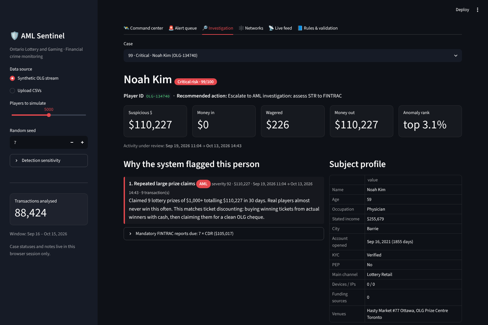

# OLG AML Sentinel

A SOC-style monitoring tool for OLG anti-money-laundering investigators. It watches every
player's transactions across OLG.ca, land-based casinos and lottery retail, picks out the
people who look like they are laundering money ("turning dirty money clean"), and puts each
one on a dashboard with what an investigator needs next: **name, how much money, when it
happened, and exactly why the software thinks it is laundering.**



## Run it

```bash
python -m venv .venv
source .venv/bin/activate        # Windows: .venv\Scripts\activate
pip install -r requirements.txt
streamlit run app.py
```

It opens at http://localhost:8501 with a simulated month of OLG activity (5,000 players and about
88,000 transactions by default, up to 20,000 players from the sidebar).

Other commands:

```bash
python -m sentinel.evaluate                       # how well the engine catches the planted launderers
python -m sentinel.data_generator --players 5000  # write data/players.csv and data/transactions.csv
python -m pytest -q                               # tests
```

## What the dashboard shows

| Tab | What it is for |
| --- | --- |
| **Command center** | Totals at a glance: transactions, money moved, open cases, AML escalations, dollars under suspicion. Also shows alerts per day, which laundering patterns are showing up, and the 10 riskiest people. |
| **Alert queue** | Every flagged person ranked by risk, with name, player ID, suspicious amount, first and last seen, rules hit and the recommended action. You can filter it, search it and export it to CSV. |
| **Investigation** | The full case file for one person. It includes every reason they were flagged, with the amount, time window and transaction count for each, plus their profile (age, job, stated income, KYC, PEP, devices, funding sources, venues) and linked accounts. It also has a timeline of their money against the $10,000 line, the flagged transactions, a case status and notes, and an editable **draft STR narrative**. You can download the case as JSON, CSV or TXT. |
| **Networks** | Groups of accounts that share one device or IP address (mule rings). |
| **Live feed** | Replays the transaction stream in time order like a SOC console, with alerts appearing as their evidence completes. |
| **Rules & validation** | Explains every rule and its current thresholds, and checks the results against the planted launderers. |



## How it decides someone is suspicious

### 1. Typology rules (known laundering methods)

| Rule | What triggers it |
| --- | --- |
| Structuring / smurfing | Money-in is split into 2 or more pieces so that each 24-hour total is $7,500 to $9,999, staying just under the $10,000 FINTRAC threshold. The score goes up each time it repeats. |
| Minimal play / pass-through | Money comes in and less than 30% of it is wagered before at least 70% goes back out within 48 hours as a cheque or EFT ("chip walking"). |
| Hedged betting | Big wagers where under 10% of the stake is actually at risk, for example betting on both red and black. |
| Shared device / IP ring | 3 or more accounts on the same device or IP address (money mules or multi-accounting). |
| Many funding sources | More cards or prepaid instruments than a normal player uses. |
| Repeated large prize claims | 3 or more lottery prizes of $1,000+ in a month. This is ticket discounting: buying winning tickets from real winners for cash. |
| Location masking | OLG.ca activity from VPN, proxy or out-of-province IP addresses. |
| Affordability mismatch | Money moved, annualised, is more than 4× the stated income for the player's occupation. |
| Sudden spike vs. history | The last 7 days of money-in is 8× or more the player's own weekly average. |
| New account, high value | The account is under 30 days old and has already moved $5,000+. |
| PEP high-value | A politically exposed person is moving $10,000+. |
| LCTR / CDR | $10,000+ in cash received, or paid out, within 24 hours. These are mandatory FINTRAC reports and on their own are not evidence of laundering. |
| Loss chasing | Escalating repeat deposits between midnight and 5 AM. This is gambling harm, so the case goes to **PlaySmart**, not AML. |

### 2. Machine learning anomaly detection

An Isolation Forest scores each player's whole profile against everyone else's. The profile
covers money in and out, wagering ratio, devices, funding sources, night activity,
out-of-province share, prize claims, stake at risk and money compared with income. The model
flags the most unusual 1% of players and explains each flag with the features that were
furthest from normal.

### 3. Risk score and routing

The alerts for one person roll up into one case. The risk score starts from the strongest
alert, and each additional alert closes part of the remaining gap to 100 with less weight than
the one before. Cases are routed as follows:

- **Escalate to AML investigation (assess STR):** matches a laundering method and risk is 65 or higher.
- **Refer to PlaySmart:** shows gambling-harm signals.
- **Enhanced monitoring:** has unusual profile signals only.
- **File LCTR / CDR:** a mandatory report only.

## Results on the simulated data

The generator hides 65 launderers across 7 typologies, plus 10 problem gamblers, among 5,000
normal players. The engine never sees those labels.

```
Analysed 88,424 transactions for 5,000 players in 5.2s
Escalated to AML: 66   Analyst review: 2
Planted launderers escalated: 65/65 (recall 100%)
Escalations that are planted launderers: 98%
```

The one remaining escalation is a problem gambler whose escalating deposits also form a
structuring pattern. Normal high rollers trigger LCTR/CDR filings, not AML escalations.

## Using your own data

Choose **Upload CSVs** in the sidebar.

`transactions.csv` columns: `tx_id, timestamp, player_id, channel (OLG.ca | Casino | Lottery Retail),
venue, tx_type (DEPOSIT | CASH_BUY_IN | WAGER | WIN | WITHDRAWAL | CASH_OUT | PRIZE_CLAIM), amount,
payment_method, funding_source, game, stake_at_risk_pct, device_id, ip_address, ip_region`

`players.csv` columns: `player_id, name, age, occupation, est_annual_income, city, account_created,
kyc_status, pep, primary_channel`

## Project layout

```
app.py                     Streamlit dashboard
sentinel/engine.py         rules, anomaly model, case roll-up, STR draft
sentinel/data_generator.py synthetic OLG stream with planted laundering typologies
sentinel/evaluate.py       catch-rate report against the planted ground truth
tests/                     engine tests
```

All people and transactions here are synthetic.
